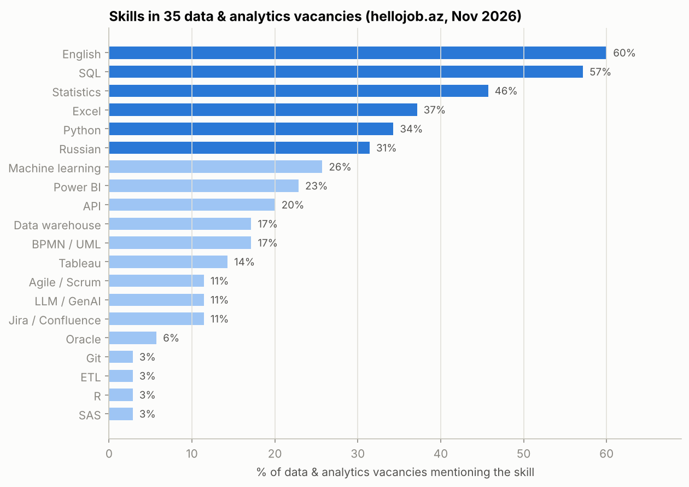
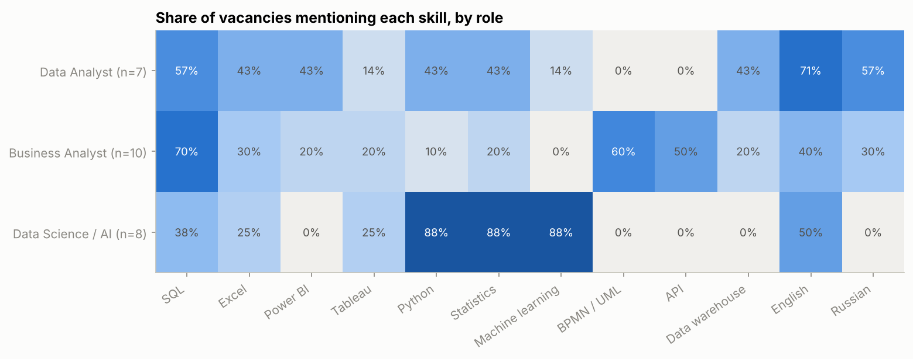
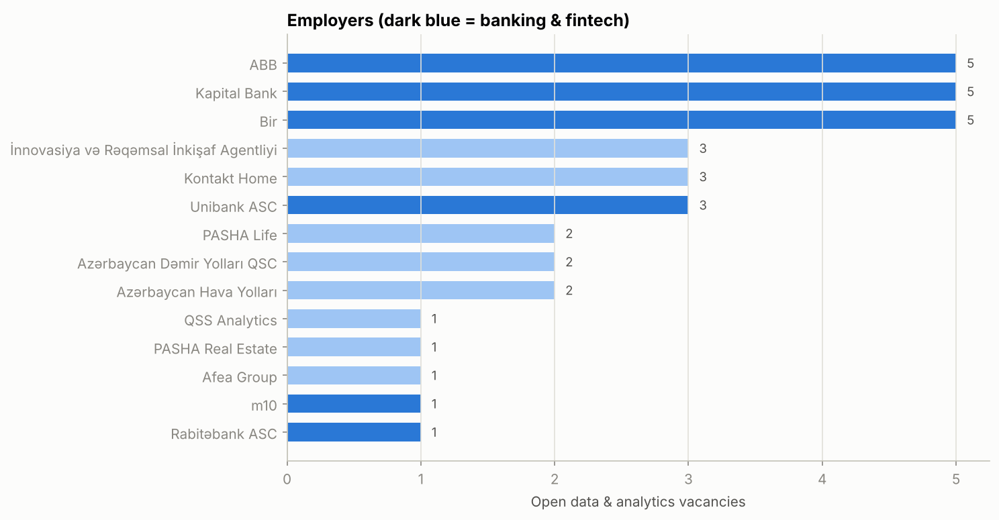
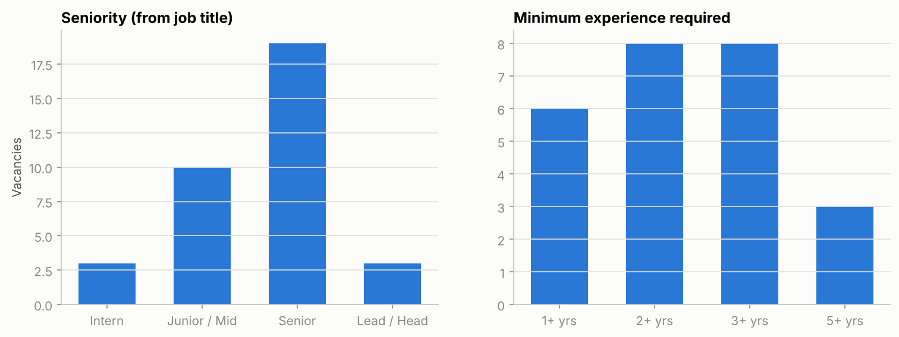

# What Does Azerbaijan's Job Market Want from Data Analysts?

I scraped and analyzed **data & analytics vacancies in Azerbaijan** to answer a question every student in this field has:
*Which skills should I actually learn to get hired here?*

**Tools:** Python · requests · BeautifulSoup · regex-based text extraction (Azerbaijani + English) · pandas · matplotlib · Jupyter  
**Data:** [hellojob.az](https://www.hellojob.az), snapshot of **23 Nov 2026**. 171 vacancy pages matched data-related searches; **35 are data & analytics roles**.

**Live dashboard:** _link after deploy_ · data refreshes daily via GitHub Actions

---

## Key findings



| # | Finding |
|---|---|
| 1 | **SQL is the core technical skill.** It appears in **57%** of data vacancies, more than any other tool, and in 70% of Business Analyst roles. |
| 2 | **English matters as much as SQL (60%).** Russian is requested in **31%**. |
| 3 | **Power BI beats Tableau (23% vs 14%)** in this market. |
| 4 | **Statistics (46%) and Python (34%)** separate analysts from report builders. Both appear in 88% of Data Science roles. |
| 5 | **57% of vacancies come from banking & fintech** (ABB, Kapital Bank, Bir, Unibank, Rabitəbank, m10). |
| 6 | **Experience is the entry barrier.** 54% of roles are senior-titled, and the median minimum experience is **2 years**. |
| 7 | **0 of 35** data vacancies publish a salary (5 of all 171 scraped pages do). |

### Each role asks for a different toolkit



- **Data Analyst:** SQL, English, plus Excel, Power BI, Python and DWH knowledge
- **Business Analyst:** SQL, BPMN/UML process modeling and API understanding. This role is closer to IT than to statistics.
- **Data Science / AI:** Python, statistics and machine learning (88% each). BI tools are not mentioned.

### Who is hiring and at what level





---

## What this means: my learning plan

1. **Advanced SQL** (window functions, CTEs, query optimization). See my [ecommerce-sql-analysis](https://github.com/rustamliyusif/ecommerce-sql-analysis) project.
2. **Power BI + Excel** for reporting and dashboards
3. **Python (pandas) + statistics**. See my [ab-test-analysis](https://github.com/rustamliyusif/ab-test-analysis) project.
4. **Technical English** for interviews and documentation
5. **Banking-domain projects** (credit risk, customer segmentation, CRM analytics), because this sector does most of the hiring
6. **Internship programs** (Kapital Bank, Rabitəbank, QSS Analytics) as the realistic way in, since most roles ask for 2+ years of experience

---

## How it works

```
src/scraper.py        search hellojob.az for 11 keywords → visit each vacancy → parse JSON-LD + page text
src/features.py       filter data roles by title → role family, seniority, min. experience, 22 skill flags
src/build_dataset.py  raw JSON → data_roles.csv (latest snapshot) + vacancies_history.csv (first_seen / last_seen per vacancy)
app/streamlit_app.py  interactive dashboard: skills, employers, seniority, skill-match search, weekly trend
.github/workflows/scrape.yml   daily scrape + dataset update, commits changes back to the repo
notebooks/analysis.ipynb   charts and conclusions
```

**Skill detection** uses regular expressions written for mixed Azerbaijani/English job ads. For example, `statisti` matches both
*statistika* and *statistics*, and `maşın öyrənmə|machine learning` covers both languages. Ambiguous short tokens (`R`, `SAS`, `DAX`)
are matched case-sensitively, so they don't fire inside Azerbaijani words such as *əsas* or *daxili*.

### Re-run with fresh data

```bash
pip install -r requirements.txt
python src/scraper.py            # writes data/raw/hellojob_vacancies_<date>.json (~3 min, polite delay between requests)
python src/build_dataset.py      # rebuilds data/processed/data_roles.csv
jupyter notebook notebooks/analysis.ipynb
streamlit run app/streamlit_app.py
```

Only the processed, feature-level dataset is committed. Full vacancy texts stay local (`data/raw/` is git-ignored)
because they belong to the employers.

## Limitations

- One job board and one snapshot, with a small sample (n = 35). Results describe the market in November 2026, not a long-term trend.
- Keyword matching can miss synonyms or count a skill mentioned as "nice to have" the same as a requirement.
- Seniority comes from job titles, and banks use "aparıcı / baş mütəxəssis" inconsistently.

**Next step:** add boss.az as a second source, extend the taxonomy to all IT roles, and track how demand for each skill changes over time.

---

**Author:** Yusif Rustamli · Data Analytics student, Baku Engineering University
